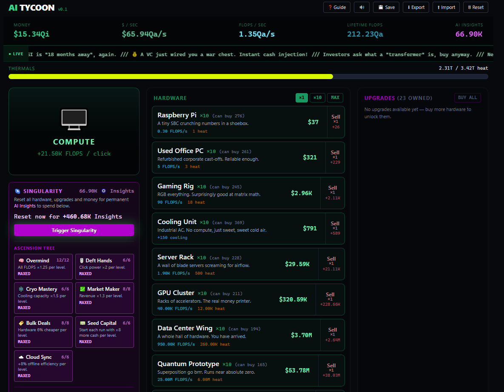

# 🖥️ AI Tycoon

An incremental / idle game about bootstrapping an AI compute empire — from a
Raspberry Pi in a shoebox to a Dyson swarm harvesting a star. Generate FLOPS,
sell them for money, reinvest in bigger hardware, fight the heat, and ascend
through Singularity Resets.

Built with **React 19 + Zustand + Vite + Tailwind**. No backend — everything
runs in the browser and saves to `localStorage`.



## How to play

1. **Click the terminal** to generate FLOPS (compute) by hand — this funds your
   first machine.
2. **Buy hardware** that produces FLOPS automatically. Higher tiers are far more
   efficient per dollar. Buy in bulk with **×1 / ×10 / MAX**, or **Sell** back
   for a 50% refund.
3. **Manage heat.** Every machine runs hot; if total heat exceeds your cooling
   capacity, production is throttled. Buy Cooling Units, Cryogenic Plants and
   cooling upgrades to stay in the green.
4. **Buy upgrades** — one-time boosts to clicking, production, cooling and
   revenue.
5. **Ride the events.** Random market events temporarily buff or debuff you
   (watch the toast and the pill up top).
6. **Ascend.** Once you've generated enough lifetime compute, trigger a
   **Singularity Reset** to convert progress into permanent **AI Insights** —
   spend them on the **Ascension Tree** and unlock cosmetic **skins**.

Progress **autosaves every 10 seconds**. Offline progress accrues while the tab
is closed (at reduced efficiency, boostable via the tree). Use **Export /
Import** in the header to back up or move your save.

## Development

```bash
npm install
npm run dev        # local dev server (http://localhost:5173)
npm run dev -- --host   # also expose on your LAN (test on a phone)
npm run build      # production build to dist/
npm run preview    # preview the production build
npm run lint       # eslint
```

## Project structure

```
src/
  store/gameStore.js    # Zustand store: all game state + pure stat math
  systems/              # gameLoop, saveSystem, sound
  data/                 # buildings, upgrades, events, achievements, tree, skins
  components/           # UI (click area, hardware/upgrade lists, panels, modals)
  utils/format.js       # compact number/money/time formatting
```

Game balance lives entirely in the `data/` files — tweak the numbers there to
rebalance without touching game logic.

## Planned

- Review game balance
- Translate to Spanish

## License

[MIT](LICENSE) © abielsaf
